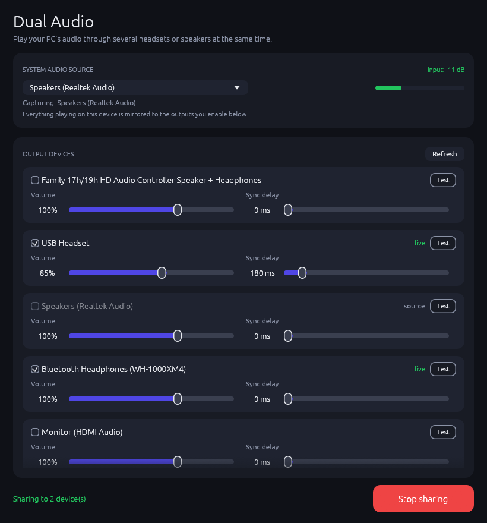

<div align="center">


# Dual Audio

**Play your PC's audio through several headphones, speakers or earbuds at the same time.**

Your OS only plays sound on one output device at a time. Dual Audio mirrors your system audio to as
many devices as you want, live: no virtual cables, no drivers, no reboots.

[](https://github.com/jere344/windows-dual-audio/releases/latest)
[](LICENSE)
[](#)
[](https://www.rust-lang.org/)



</div>

## Features

- **Multi-device output**: the same audio on 2, 3, 4+ devices at once
- **Windows and Linux**: WASAPI on Windows; PulseAudio **or PipeWire** on Linux
- **No drivers**: uses the system audio APIs, nothing to install
- **Per-device volume** (0–150 %) and **sync delay** (0–2000 ms) to line up Bluetooth latency,
  adjustable live without interrupting playback
- **Live level meter** so you can see what is being captured
- **Choose the capture source**: your default output or any other device
- **Test tone** per device to check it before sharing
- **System tray**: close the window and audio keeps playing
- **Portable**: a single native executable, no installer, no runtime

## Download

Grab the latest build from the [**Releases**](https://github.com/jere344/windows-dual-audio/releases/latest) page:

| Platform | File |
|---|---|
| Windows 10/11 (64-bit) | `DualAudio.exe` |
| Linux (x86_64, PulseAudio or PipeWire) | `dual-audio-linux-x86_64` |

On Linux, make the file executable first: `chmod +x dual-audio-linux-x86_64`.

## Quick start

1. Connect / pair all your headphones.
2. Set the one that should play "natively" as your **default output** (Windows sound settings, or
   your desktop's sound settings on Linux).
3. Run Dual Audio and tick the **other** devices you want to hear the audio on.
4. Press **Start sharing**.

### Command-line options

| Option | Effect |
|---|---|
| `--tray` | Start minimised to the tray and start sharing right away (handy for autostart) |
| `--list-devices` | Print the output devices and exit (`*` marks the default) |
| `--version` | Print the version and exit |

## How it works

```
default output ──(loopback capture)──▶ fan-out ─┬─▶ Device A  (volume, delay)
                                                 ├─▶ Device B  (volume, delay)
                                                 └─▶ Device N
```

- **Windows:** the source is captured with WASAPI loopback; each target gets its own WASAPI render stream.
- **Linux:** the source is captured from its PulseAudio/PipeWire `.monitor` source, and each target
  gets its own playback stream. The app speaks the PulseAudio protocol natively, so it needs no
  system libraries and works on PipeWire through `pipewire-pulse` (the default on modern distros).

The capture device already plays the sound, so it can't be selected as a target (that would echo).
Every enabled device gets an independent stream and a small jitter buffer. The sync delay is just
extra audio held in that buffer, so changing it never restarts the stream.

## Bluetooth out of sync?

Different headsets have different codec latency (often 150–250 ms). Raise the **Sync delay** on the
device that is *ahead* until both line up.

## Troubleshooting

| Problem | Fix |
|---|---|
| Level meter stays at `-inf dB` | Nothing is being captured. Play some audio, or pick another **source** |
| No sound on a mirrored device | Press **Test**. If it stays silent, check that device's volume/mute |
| A device shows `error` | Hover the label for details; press **Refresh** after reconnecting it |
| Netflix / Disney+ is silent (Windows) | DRM blocks capture. Use a browser (Chrome/Firefox) instead |
| No tray icon on GNOME (Linux) | Install the *AppIndicator and KStatusNotifierItem Support* extension. Without a tray, closing the window quits |

Settings live in `%AppData%\DualAudio\settings.json` (Windows) or `~/.config/DualAudio/settings.json`
(Linux). Crashes are written to `error.log` in the same folder.

## Build from source

Requires [Rust](https://rustup.rs) 1.85 or newer.

```bash
cargo build --release
```

The binary ends up in `target/release/` (`dual-audio` or `dual-audio.exe`).

**Linux:** no `-dev` packages are needed. To run, you need a running PulseAudio or PipeWire server,
plus X11 or Wayland with working OpenGL/Vulkan. See [CONTRIBUTING.md](CONTRIBUTING.md) for details.

## Star history

<a href="https://star-history.com/#jere344/windows-dual-audio&Date">
  
</a>

## License

[Apache-2.0](LICENSE)
